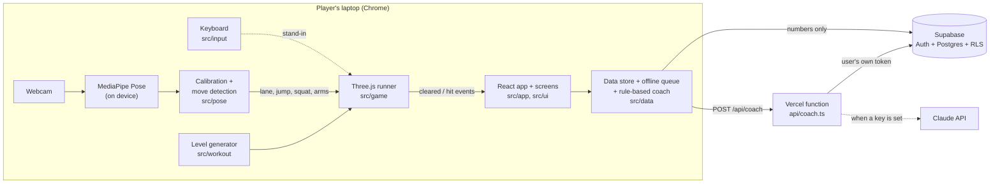

# Neon Arena

**Run Montréal with your body.** A workout you play in Chrome with your laptop's webcam: no controller, no install, no equipment. Built at CodeJam 16 (McGill).

You stand about 1.5 m from the laptop and your body steers a runner along a 3-lane street: sidestep to change lane, jump hurdles, squat under beams, raise both arms to smash crates, raise one arm to grab orbs. You pick what to train (legs, arms, shoulders or full body) and the level is generated for that workout. A round is 6 levels of 30 seconds, each one faster than the last, played inside AI-generated video clips of real Montreal streets (made with Higgsfield, the road lined up with the 3D track): the cobblestones of Old Montreal, the deck of the Jacques Cartier Bridge and the Old Port at blue hour. You have 3 lives. Pose tracking runs in the browser, so **your video never leaves your laptop**. Every round is saved to your profile, and a dashboard, a public and a friends leaderboard and a coach show you how you're doing and what to play next.

**Live:** https://codejam-jet.vercel.app (Chrome on a laptop; deployed from `main`)

## How to play

| Your body | In the game | Keyboard stand-in |
| --- | --- | --- |
| Step left or right | Change lane, dodge a block | ← → |
| Jump | Clear a hurdle | ↑ or Space |
| Squat (hold it for long beams) | Duck under a beam | ↓, held |
| Both arms up | Smash a crate | W, held |
| One arm up | Grab an orb | Q (left) or E (right), held |
| Forearms crossed in an X at chest height, 1 s | Pause; the same X resumes | Esc |

1. **Sign up** on the landing page: pick a username (it tells you if it's taken), and optionally age, weight and height (only for the calorie estimate and the coach). Or click **Play as guest**.
2. **Pick a workout**, a tier (Beginner, Regular, Athlete: how many obstacles) and Floor or Treadmill. Camera is preselected when the laptop has one. **Low impact** removes the hurdles (no jumping).
3. **Calibrate:** stand on your mark with head to knees in view and hold still for 1.5 s. Every move is then judged against your own body, so it adapts to your height and distance.
4. **Play** the 6 levels. Each hit costs a life; with none left the round ends early. Each clear is graded PERFECT, GOOD or LATE, and streaks multiply your points.
5. **Results:** score, accuracy, reps per move, estimated calories, your rank and the coach's recommended next session. With the camera, raise both arms to play again.

Before your first round, "Try each move" walks you through every move the round will use.

| Workout | Moves | Modes |
| --- | --- | --- |
| Legs | squat, jump, sidestep | Floor |
| Arms | left and right reaches, both arms up | Floor, Treadmill |
| Shoulders | overhead presses and holds, reaches | Floor, Treadmill |
| Full body | sidestep, jump, squat, both arms up | Floor, Treadmill |

Treadmill mode is for people already running on one: it uses upper-body moves only.

**Keys:** `K` switches camera ↔ keyboard mid-round without restarting, `R` recalibrates, `Esc` pauses, `D` shows the debug overlay. Switching tabs also pauses.

## Features

- **Body-controlled 3D runner** in plain Three.js, with a Canvas 2D fallback and automatic graphics levels for slow laptops.
- **6 levels × 30 s** inside generated clips of Montreal streets (built-in 3D scenery if a clip can't load or on Low graphics), 3 lives, PERFECT / GOOD / LATE grades and streak multipliers.
- **Fair on a webcam:** webcam moves arrive late, so obstacles are drawn early by each move's measured detection lag. Only the drawing moves; the judging rules stay the same.
- **Generated levels:** a seeded generator builds each round from the workout's mix of moves, with fairness rules (minimum gaps, a breather between squats, time to stand up between a beam and a hurdle) tested on every workout and mode.
- **Hands-free:** X-arms pause and resume, arms up to replay. A second person stepping into the play area pauses the round.
- **Accounts and progress:** sign-up with a unique username, or play as a guest; a dashboard with your week, day streak and recent rounds.
- **Leaderboards:** a public board of each player's best per workout and mode, and a **Friends** view: add a friend by username to see their best next to yours.
- **Coach:** after every round, a recap, a tip for the move you missed most and a recommended next session (workout and tier).
- **Ghost runner:** replay the same level and a see-through runner replays your best run beside you (stored in this browser only).
- **Kiosk mode** (`?kiosk=1`): a leaderboard-only screen for a demo table, with a QR code to the live site, refreshing every 15 s.
- **Works offline:** rounds played without a connection wait in a local queue and sync later; with no backend at all, everything runs on the local store.

## Privacy

- **The video never leaves the laptop.** Pose tracking (MediaPipe) runs in the browser, and the model is downloaded from our own site, not a CDN. No frame and no body landmark is sent anywhere. Only `src/data` talks to the network; `src/pose` makes no network call.
- **What we store per player** (Supabase Postgres): an anonymous account (no email, no password, no phone) and a profile with the username you type, goal, fitness level, weekly goal, and age, weight and height only if you enter them. Per round: workout, mode, length, score, accuracy, streak, reps and misses per move, estimated calories, date.
- **Who can read it:** row-level security on every table. You can read and write only your own profile and rounds, and a saved round can't be changed or deleted. The leaderboard shares only a name, workout, mode, round length, score and date (each player's best). Friends see the same, nothing more; adding a friend is one-way, so nobody can put themselves on your board.
- **The coach:** no Claude key is configured for the demo, so the card is the rule-based coach, which runs in the browser on your own numbers. When a key is set, the server sends Claude your profile's name, goal, level and weekly goal and your last 10 rounds' numbers. Never your age, weight or height, never video.
- **Being forgotten:** "New player" signs you out on this laptop and erases the local copy. Server rows stay anonymous until we delete them; ask us and we will.

Full details: [docs/LIVE.md](docs/LIVE.md) ("Privacy").

## Tech stack

Vite, React 19, TypeScript (strict), Tailwind CSS, shadcn/ui (Radix), Motion, Recharts, plain Three.js, MediaPipe Tasks Vision (Pose Landmarker lite, on the GPU, served from `public/`), Supabase (Auth, Postgres, row-level security), Vercel serverless functions, Claude API (`@anthropic-ai/sdk`), Vitest.



- **One contract file** (`src/contracts/index.ts`): modules never import each other; only `src/app` wires them together. Every outside dependency has a stand-in behind the same interface: keyboard for the camera, local store for Supabase, rule-based coach for Claude.
- **Pose** (`src/pose`): calibration records hip centre, shoulder width and torso length; every threshold is a fraction of those. Design notes: [src/pose/DECISIONS.md](src/pose/DECISIONS.md).
- **Game** (`src/game`): its own loop, outside React. Details: [src/game/README.md](src/game/README.md).
- **Backend** (`src/data`, `supabase/migrations`, `api/`): anonymous sign-in, `profiles` and `sessions` behind row-level security, a `leaderboard` view of each player's best, friends through security-definer functions, and database checks that refuse impossible scores. The coach endpoint checks the player's token, reads their history under row-level security (no service key), allows one call per player per 10 s, asks Claude for structured JSON with a 7 s timeout and validates the answer; any failure falls back to the rules.

## Run it locally

```bash
npm install
npm run dev        # http://localhost:5173
```

- With no `.env.local`, the app uses the **local store** (browser storage): everything works, but the leaderboard shows only this browser's players and there are no friends. For Supabase, copy `.env.example` to `.env.local` and fill in `VITE_SUPABASE_URL` and `VITE_SUPABASE_ANON_KEY`.
- `npm run dev` doesn't serve `/api`, so the coach card is the rule-based coach.
- `npm run check` runs the typecheck, lint, Vitest suite and production build.

| URL flag | Effect |
| --- | --- |
| `?demo=1` | Every round is the same fixed Full body level (seed 11475), so it can be rehearsed |
| `?store=local` | No backend: store everything in this browser |
| `?kiosk=1` | Leaderboard-only screen with a QR code |
| `?dev=pose` | Pose debug page: live landmarks, thresholds, move tally, clip recorder |
| `?gfx=low` / `?gfx=2d` | Lower graphics (built-in scenery instead of video) / force the Canvas 2D fallback |
| `?mute=1`, `?music=off` | No sound / effects only |
| `?ghost=off`, `?intro=off` | No ghost runner / no 3-2-1 intro |

Example: http://localhost:5173/?demo=1&store=local

## Team

| Person | Built | Folders |
| --- | --- | --- |
| Abdo | Camera, MediaPipe, calibration, move detection, X-arms gesture, pose debug page | `src/pose/` |
| Patrick | Three.js runner, keyboard input, game audio, ghost runner, level generation, scoring and stats | `src/game/`, `src/input/`, `src/workout/` |
| Greg | Screens, HUD, dashboard and app wiring; Supabase store, SQL migrations, friends, coach endpoint; contracts and docs | `src/app/`, `src/ui/`, `src/data/`, `supabase/`, `api/`, `docs/` |

AI coding assistants helped write code against interfaces the team designed. The team did the architecture, the tuning in front of the camera and the playtesting.

## More docs

| Doc | What it covers |
| --- | --- |
| [docs/DEMO.md](docs/DEMO.md) | Pitch script, demo fallbacks, judge Q&A |
| [docs/DEVPOST.md](docs/DEVPOST.md) | Devpost story |
| [docs/CONTRACTS.md](docs/CONTRACTS.md) | Shared interfaces, database schema, endpoint, collision and level rules, detection thresholds |
| [docs/LIVE.md](docs/LIVE.md) | Live site, backend security checks, privacy |
| [docs/PLAN.md](docs/PLAN.md) | The original build plan |
| [AGENTS.md](AGENTS.md) | Rules every AI coding tool on the team follows |
