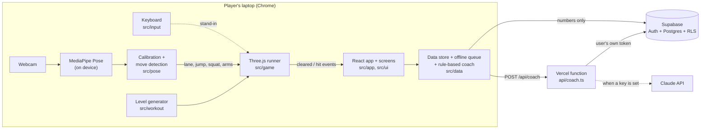

# Neon Arena

**A workout you play with your whole body, using only your laptop's webcam.** Built at CodeJam 16 (McGill).

Pick what to train (legs, arms, shoulders or full body) and a 3-lane neon runner is generated for that workout, through a city, a tunnel and a bridge, to a synthesised beat that speeds up as you go. You stand about 1.5 m from the laptop: sidestep to change lane, jump hurdles, squat under beams, raise your arms to smash crates and grab orbs. Each move is graded PERFECT, GOOD or LATE. Pose tracking runs in the browser, so **the video never leaves your laptop**. Every round is saved to your profile, a dashboard tracks your week, a leaderboard ranks best scores per workout, mode and round length (45, 90 or 180 s), a ghost runner replays your best run beside you, and a coach recommends your next session. A treadmill mode uses upper-body moves only.

Live site: https://codejam-jet.vercel.app (deployed from `main`). Chrome only.

## How to play

| Your body (name in the app) | In the game | Keyboard stand-in |
| --- | --- | --- |
| Step left or right (SIDESTEP) | Change lane, dodge blocks | ← → |
| Jump (JUMP) | Clear a hurdle | ↑ or Space |
| Squat, held for long beams (SQUAT) | Duck under a beam | ↓, held |
| Both arms up (ARMS UP) | Smash a crate | W, held |
| One arm up (REACH LEFT / REACH RIGHT) | Grab an orb | Q (left) or E (right), held |

| Workout | Moves | Modes |
| --- | --- | --- |
| Legs | squat, jump, sidestep | floor |
| Arms | left and right reaches, both arms up | floor, treadmill |
| Shoulders | overhead presses and holds, reaches | floor, treadmill |
| Full body | sidestep, jump, squat, both arms up | floor, treadmill |

Treadmill mode generates only crates and orbs. "Low impact" removes hurdles. Before the first round, "Try each move" walks through every move of the coming round.

**Flow:** landing → profile (or play as a guest) → pick a workout (Camera is preselected when the laptop has one; Keyboard is remembered if chosen) → calibration (camera: stand on your mark, head to knees in view, still for 1.5 s) → 3-2-1 → round → results with the coach card → dashboard and leaderboard.

**Hands-free:** cross your forearms in an X at chest height for 1 s to pause; the same X resumes. On results, raise both arms to play again.

**Keys during play:** `K` switches camera ↔ keyboard without restarting the round, `R` recalibrates, `Esc` pauses, `D` shows the debug overlay.

## Run it locally

```bash
npm install
npm run dev        # http://localhost:5173
```

- With no `.env.local`, the app uses the **local store** (browser storage): everything works, and the leaderboard shows only this browser's player.
- For Supabase, `cp .env.example .env.local` and fill in `VITE_SUPABASE_URL` and `VITE_SUPABASE_ANON_KEY` (public anon key; row-level security protects the data).
- `npm run dev` does not serve `/api`, so the coach card shows the rule-based coach. `npx vercel dev` serves the coach endpoint too.
- `npm run check` runs typecheck, lint, the Vitest suite and the production build.

| URL flag | Effect |
| --- | --- |
| `?demo=1` | Every round is the fixed 45 s Full body demo level (seed 41492) |
| `?store=local` | Skip the backend; store everything in this browser |
| `?kiosk=1` | Leaderboard-only screen (Full body · floor · 45 s) with a QR code, refreshes every 15 s |
| `?dev=pose` | Pose debug page: live landmarks, thresholds, move tally, clip recorder |
| `?gfx=low` / `?gfx=2d` | Lower graphics / force the Canvas 2D fallback (otherwise automatic) |
| `?mute=1`, `?music=off` | No sound / effects only, no music |
| `?ghost=off`, `?intro=off` | No ghost runner / no 3-2-1 intro |

## Architecture



- **Modules talk through one contract file** (`src/contracts/index.ts`). They never import each other; only `src/app` wires them together. Every outside dependency has a stand-in behind the same interface: keyboard for the camera, local store for Supabase, rule-based coach for Claude.
- **Pose** (`src/pose`): MediaPipe Pose Landmarker (lite model, GPU, served from `public/`, no CDN). Calibration records the player's hip centre, shoulder width and torso length, and every threshold is a fraction of those, so it adapts to height and distance. Design notes: [src/pose/DECISIONS.md](src/pose/DECISIONS.md).
- **Game** (`src/game`): plain Three.js with its own loop outside React. Each object is judged over a window (0.35 s before to 0.15 s after arrival). With the camera, objects are drawn ahead of the judging clock by each move's measured detection lag (0.1 s for jumps up to 0.3 s for squats and arms), so reacting on sight lands inside the window. Details: [src/game/README.md](src/game/README.md).
- **Levels** (`src/workout`): seeded generator with a warm-up, build, peak and cool-down, and fairness rules tested on every workout, mode and length.
- **Backend** (`src/data`, `supabase/`, `api/`): anonymous guest sign-in; `profiles` and `sessions` behind row-level security (each user reads only their own rows); a `leaderboard` view that exposes only each player's best per workout, mode and round length (name, score, date). One board per length, because a 180 s round scores about 6× a 45 s one. Rounds played offline wait in a local queue and sync later.
- **Coach:** `POST /api/coach` checks the user's token, reads their history through row-level security (no service key), applies a per-user rate limit (one call per 10 s, atomic in Postgres), asks Claude for structured JSON with a 7 s timeout, and validates the answer. **No Claude key is configured for the demo**, so the card you see is the rule-based coach in `src/data/coach.ts`: it recommends the workout you played least this week, moves difficulty up or down from your accuracy, and points the tip at the move you missed most. Adding `ANTHROPIC_API_KEY` on the server turns the Claude path on. Its answer validation and rate limit are unit-tested; it has not yet answered with a real key.

## Privacy

- Video and body landmarks are processed in the browser and never sent anywhere.
- The server stores only numbers per round (reps, score, accuracy, duration, estimated calories) and a short profile (display name, goal, fitness level, weekly goal, optional weight).
- Each user can read only their own profile and sessions. Other players see only the leaderboard (name and best score).
- Ghost runs (lane, jump, squat and arm states, about 1 KB per 45 s level) stay in this browser's storage.
- Guests are anonymous; there is no email or password.

## Team

| Person | Built | Folders |
| --- | --- | --- |
| Abdo | Camera, MediaPipe, calibration, move detection, pose debug page | `src/pose/` |
| Patrick | Three.js runner, keyboard input, game audio, ghost runner, level generation, scoring and stats | `src/game/`, `src/input/`, `src/workout/` |
| Greg | Screens, HUD, dashboard and app wiring; Supabase store, SQL migrations, coach endpoint; contracts and docs | `src/app/`, `src/ui/`, `src/data/`, `supabase/`, `api/`, `docs/` |

AI coding assistants helped write code against interfaces the team designed. The team did the architecture, the tuning in front of the camera and the playtesting.

## Tech stack

Vite, React 19, TypeScript (strict), Tailwind CSS, shadcn/ui (Radix), Motion, Recharts, Three.js, `@mediapipe/tasks-vision`, Supabase (Auth, Postgres, row-level security), Vercel serverless functions, Claude API (`@anthropic-ai/sdk`), Vitest.

## More docs

| Doc | What it covers |
| --- | --- |
| [docs/CONTRACTS.md](docs/CONTRACTS.md) | Shared interfaces, database schema, endpoint, collision and level rules, detection thresholds |
| [docs/PLAN.md](docs/PLAN.md) | The original build plan |
| [docs/DEMO.md](docs/DEMO.md) | Pitch script, demo fallbacks, judge Q&A |
| [docs/OPERATOR.md](docs/OPERATOR.md) | One-page card for the person at the laptop on demo day |
| [docs/SUBMISSION.md](docs/SUBMISSION.md) | Devpost text, video shot list, screenshots |
| [docs/QA.md](docs/QA.md) | QA findings and their status; [docs/qa/sweep/](docs/qa/sweep/) replays the whole flow at three sizes |
| [AGENTS.md](AGENTS.md) | Rules every AI coding tool on the team follows |
